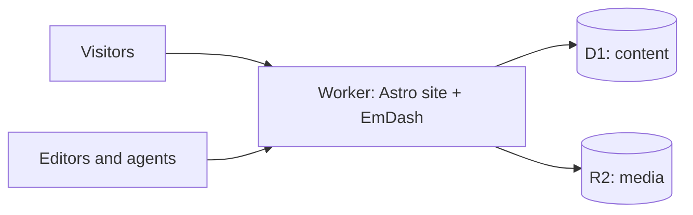

# In two hours, you'll have a live CMS that an AI agent runs for you

<!--
The promise, part one. Say it plainly.
-->

---
layout: statement
---

# …and an AI plugin you wrote that holds an API key and can't leak it

<!--
The promise, part two.

Switch to the finished site (or the fallback video): the agent tries to publish a draft, the plugin rejects it for having no cover, the agent calls the plugin's own tool to generate one, and the post goes live with an AI-generated cover.

"That's where you'll be at the end. Let's get you there."
-->

---
layout: section
---

# Introduction to EmDash

A full CMS that lives inside your Astro site

---

# EmDash is an Astro integration

```js {all|8-11}
// astro.config.mjs
import { defineConfig } from "astro/config";
import emdash from "emdash/astro";
import { d1, r2 } from "@emdash-cms/cloudflare";

export default defineConfig({
  integrations: [
    emdash({
      database: d1({ binding: "DB" }),
      storage: r2({ binding: "MEDIA" }),
    }),
  ],
});
```

<!--
That's the whole architecture in one line: you don't run a CMS next to your site, the CMS is part of your site.

Matt: a good moment for the "why we built it this way" story.
-->

---

# What you get from `emdash()`

<v-clicks>

- An admin at `/_emdash/admin`
- A REST API
- Auth with passkeys
- A media library
- Plugins
- An MCP server at `/_emdash/api/mcp`

</v-clicks>

<!--
No separate backend. Your pages read content in-process, not over HTTP.

The last one is the one we'll spend the most time with today.
-->

---
layout: two-cols-header
---

# Where it runs

::left::

### On Cloudflare

- **Workers** run the site and the admin
- **D1** holds content
- **R2** holds media

The first deploy creates all three.

::right::

### On Node

- SQLite, libSQL or Postgres
- S3-compatible or local storage

No Cloudflare account needed.

<!--
Name the platform primitives as they come up. Workers runs the code, D1 is SQLite at the edge, R2 is object storage.

Today we use Cloudflare. If someone has no account: the local track uses Node and SQLite.
-->

---

# One Worker, everything inside



---

# Content types live in the database

Each collection is a real SQL table. You change the model in the admin, not in code.

```sql
SELECT title, featured, subtitle
FROM ec_posts
WHERE status = 'published';
```

<!--
In Part 1 you add two fields in the admin (step 4), then pull generated types with `npx emdash types`.
-->

---

# Rich text is Portable Text

Structured JSON, not HTML

```json
[{
  "_type": "block",
  "style": "normal",
  "children": [{ "_type": "span", "text": "Hello, CMS Conf" }]
}]
```

<!--
A typed tree instead of markup, which is why an agent can write a post without producing broken HTML.
-->

---

# What we'll do with it

<v-clicks>

1. **Ship**: deploy a blog and change its content model
2. **Automate**: hand it to an AI agent, with limits you choose
3. **Extend**: write an AI plugin that can't leak its key

</v-clicks>

<!--
One blog, built up across all three parts. The agent in Part 2 is connected to the site you deployed in Part 1, and the plugin in Part 3 is installed on that same site.
-->
