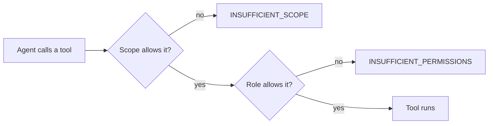

# How EmDash works with agents

Part 2 · Automate

<!--
0:42. Everyone should have a deployed site with a claimed admin. If not: Checkpoint A.
-->

---

# Three ways in

<v-clicks>

- **MCP server**: agents work with your content
- **CLI**: scripts and CI
- **Agent skills**: agents work on your code

</v-clicks>

<!--
Three surfaces, two jobs. MCP and the CLI are for operating the site. Skills are for building it.

Today: MCP for the content desk (steps 5 to 7), skills for the code change (step 8).
-->

---

# The MCP server

Built into every site

```txt
https://<your-site>.workers.dev/_emdash/api/mcp
```

<v-click>

About 70 tools: content, media, tags, menus, schema, search…

</v-click>

<!--
Tool names look like content_create, content_publish, media_update, taxonomy_create_term, schema_create_field. Plugins can add their own; you'll write one in Part 3.
-->

---

# Connecting your agent

```bash
# Claude Code
claude mcp add --transport http emdash-site <url>

# Codex
codex mcp add emdash-site --url <url>
```

The guide covers OpenCode, Cursor and VS Code too.

<!--
No API key to copy. Signing in triggers OAuth: your browser opens your own site, you sign in with your passkey, and you see a consent screen.
-->

---

# The CLI

```bash
npx emdash content list posts
npx emdash schema get posts
```

Outputs JSON, so it pipes into anything.

<!--
Also the fallback if your agent can't do MCP: the same tasks work with the CLI.
-->

---

# Agent skills

In `.agents/skills/`, shipped with the template

- `building-emdash-site`
- `creating-plugins`
- `emdash-cli`

<!--
They teach coding agents the current EmDash APIs, so they don't make them up from training data. We come back to these in step 8.
-->

---
layout: statement
---

# You choose what the agent may do

<!--
First appearance of the consent screen. It comes back in Part 3.
-->

---

# The consent screen

Every box starts ticked. Keep exactly five:

<v-clicks>

- `content:read`
- `content:write`
- `media:read`
- `media:write`
- `schema:read`

</v-clicks>

<v-click>

Untick everything else, including `schema:write`.

</v-click>

<!--
The screen shows descriptions, not scope names. The guide lists both.
-->

---

# Why these five

<v-clicks>

- `content:write` already covers tags and menus
- `media:write` doesn't include `media:read`, which is needed to list images
- `schema:read` lets the agent check fields instead of guessing
- No `schema:write`: the agent writes content, it doesn't redesign your site

</v-clicks>

---

# Two checks on every call



---
layout: statement
---

# Scopes limit the token. Roles limit the person.

The agent gets the smaller of the two.

<!--
You're an admin, so your role allows schema changes. The token you gave the agent doesn't, so the agent can't, even though you could.

And the other way round: ticking `admin` for an Editor account doesn't make the agent an admin.
-->

---

# Your turn

<v-clicks>

5. **Connect** your agent and pick the five scopes
6. **Run your content desk**: drafts, tags, alt text, a scheduled post
7. **Hit the guardrail**
8. **Agent as developer**

</v-clicks>

<!--
Drafts have no images on purpose: Part 3 generates the covers. Don't publish them yet, the payoff needs them as drafts.

Watch for: the post's image field keeps its own copy of alt. If the agent only updates the media library, the site still shows the old text.

Step 8 is the first thing to cut if we're behind.
-->

---

# Hitting the guardrail

> Add a `reading_level` select field to the Posts collection.

<v-click>

```txt
INSUFFICIENT_SCOPE
Insufficient scope: requires schema:write
```

</v-click>

<v-click>

Not a bug. That's the permission model working.

</v-click>

<!--
The schema tools are listed, but the call fails. You cleared schema:write, so the token can't change your content model.

If agents misbehave on stage: "This is exactly why Part 3 exists. You don't rely on the agent behaving, you enforce it."
-->

---

# Agent as developer

> Add a "Related posts" section to the bottom of every post page.

<v-clicks>

- `AGENTS.md` and the skills give it today's EmDash APIs
- The docs MCP (`search_docs`) lets it check instead of guess

</v-clicks>

<!--
The Blog template already shows reading time, so we ask for Related posts instead.
-->

---

# Review the diff

```ts
entry.id       // the slug
entry.data.id  // the database ID: what tags reference
```

The kind of detail an agent gets wrong without the rules file.

<!--
Review together. The point isn't that the agent can write code; it's that skills keep it on current APIs.

Checkpoint B at the end of this part: site code so far plus the cover-images starter.
-->

---
layout: statement
---

# The agent does the work. You decide what it can touch.

<!--
Bridge into the break. Scopes protect you from the agent. Part 3 is about protecting you from plugin code.
-->
